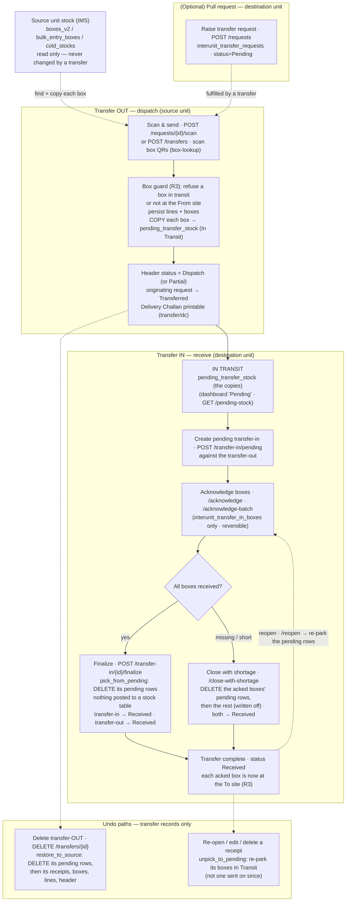

# Candor inter-unit transfer flow — Request → Dispatch → In-transit → Receive

The record of boxes going from one unit / cold store to another in the v2 stack:
an optional pull request, a source-unit dispatch (delivery challan) that copies its
boxes into the in-transit table, and a destination-unit receipt that acknowledges
them and clears those copies — plus the undo paths.

**Record only.** An inter-unit transfer never writes the stock tables
(`{cfpl,cdpl}_boxes_v2`, `_articles_v2`, `_bulk_entry_boxes`, `_cold_stocks`, which
IMS keeps). It reads them to find and copy a box, and writes only the transfer
records (`interunit_*`) and `pending_transfer_stock`. The Inner Cold transfer is the
one exception, by design (below). Endpoints, statuses, and tables below are the real
ones in `app/modules/transfer` (base path `/api/v1/transfer`).

## Flow diagram



## Inner-cold transfer (the exception — edits cold rows in place, inside one store)

```mermaid
flowchart LR
    IC1["Inner-cold transfer · POST /inner-transfer<br/>(transfer/innercoldtransfer)"] --> IC2["Edit the picked cold-stock rows in place<br/>cfpl_cold_stocks / cdpl_cold_stocks<br/>relabel the lot · change the location<br/>within the same store only"]
    IC2 --> IC3["Grouped by challan_no · validate-all-then-apply (atomic)<br/>another cold store → 409 (an inter-unit transfer)"]
    IC3 -.->|DELETE /inner-transfer/{challan_no}| IC4["Undo: restore every changed row,<br/>delete the rows it inserted (one transaction)"]
```

## Phase → mechanics

| Phase | Endpoint(s) | Key tables | Effect |
|---|---|---|---|
| Request (optional) | `POST /requests` · `GET/DELETE /requests/{id}` | `interunit_transfer_requests` (+ lines) | request raised · `status=Pending` |
| Transfer out | `POST /requests/{id}/scan` · `POST /transfers` · `PUT /transfers/{id}` · box-lookup | `interunit_transfers_header` (+ lines/boxes), **`pending_transfer_stock`**; stock tables read only | each box **copied** in transit · **stock untouched** · status `Dispatch`/`Partial` · request → `Transferred` |
| In transit | `GET /pending-stock` · `…/by-lot` | `pending_transfer_stock` | dispatched-not-received tracking |
| Transfer in — open | `POST /transfer-in/pending` · `…/by-transfer-out/{id}` | `interunit_transfer_in_header/_boxes` | pending receipt opened |
| Transfer in — ack | `POST …/{id}/acknowledge` · `/acknowledge-batch` · `DELETE …/acknowledge/{box}` | `interunit_transfer_in_boxes` | box-by-box ack (record only, reversible) |
| Transfer in — finalize | `POST …/{id}/finalize` · `/close-with-shortage` | `pending_transfer_stock`, `interunit_*` headers | **pending rows deleted, nothing posted** · both headers `Received` (shortage written off) |
| Undo | `POST /transfer-in/{id}/reopen` · `PUT /transfer-in/{id}` · `DELETE /transfer-in/{id}` · `DELETE /transfers/{id}` · `POST /pending-stock/backfill` | `pending_transfer_stock`, `interunit_*` | transfer records only: pending rows re-parked (`unpick_to_pending`) or dropped (`restore_to_source`); backfill parks old transfers' boxes |
| Inner-cold | `POST /inner-transfer` · list/get/delete | `cfpl_cold_stocks` / `cdpl_cold_stocks`, `inner_cold_transfer` | **the exception**: lot relabel / location change inside one store, rows edited in place · delete undoes it |

## Notes

- **Stock never moves.** Dispatch **copies** each box — its stock row's values,
  table and id, and for a cold box a snapshot of its cold row — into
  `pending_transfer_stock` (In Transit), in one transaction, and leaves the stock row
  as it is. Acknowledging writes only `interunit_transfer_in_boxes`. Finalize and
  close-with-shortage only **delete** the transfer's pending rows. Nothing is deducted
  from the source or posted to the destination: a box in transit is still in its
  source stock table, and the pending table (what the dashboard "Pending" view reads)
  and the transfer records say where it is.
- **Where a box is (R3).** Because the stock tables never change, a box's latest
  transfer decides where it is (`lookup_service.unavailable_boxes`): no transfer —
  available from any site; in transit (Dispatch / Partial, or no receipt yet) or
  written off as short — unavailable; received and acknowledged — available only from
  that transfer's To site (sites compared through `app.core.sites`, so
  `Warehouse A185` is `A185`). The box lookups, Scan & send, `POST` / `PUT /transfers`
  and the cold pick all apply it.
- **Statuses are text.** Transfer-out headers carry `Dispatch` / `Partial`
  (recomputed from the boxes shipped vs ordered) and flip to `Received` on
  finalize; transfer-in headers go `Pending → Received` (finalize needs
  ≥ 1 acknowledged box) and back to `Pending` on reopen; the request row flips
  `Pending → Transferred` when a transfer consumes it.
- **Box integrity guard.** A duplicate `(box_id, transaction_no)` is rejected on
  persist — the guard against the "boxes collapsed to 1" inventory-loss bug;
  each scanned box is matched to its line by article.
- **Undo paths touch transfer records only.** `update_transfer` drops the
  transfer's pending rows (`restore_to_source`, despite its name) and re-parks each
  kept box from its own copy; deleting a transfer-out drops its pending rows and its
  receipts; re-opening, editing or deleting a receipt re-parks its boxes In Transit
  (`unpick_to_pending`), except a box a newer transfer has taken on since. No undo
  writes a stock table, because nothing was written there to undo. Every path is
  one transaction.
- **Inner-cold is the exception.** It is the one transfer path that edits
  `cfpl_cold_stocks` / `cdpl_cold_stocks`, in place and on purpose: it relabels the
  lot of the boxes the user picked, or changes their location, inside one store only
  (moving boxes to another cold store has to be an inter-unit transfer: 409). Deleting
  the challan restores every row it changed and deletes the rows it inserted. It never
  parks to `pending_transfer_stock`.
- **Relation to the other flows** — transferred RM/SFG/FG is the same inventory
  the [purchase flow](./purchase-flow.md) inwards and the
  [production flow](./so-to-jobcard-flow.md) consumes; a transfer records it going
  between units, while the stock tables stay as IMS keeps them.
