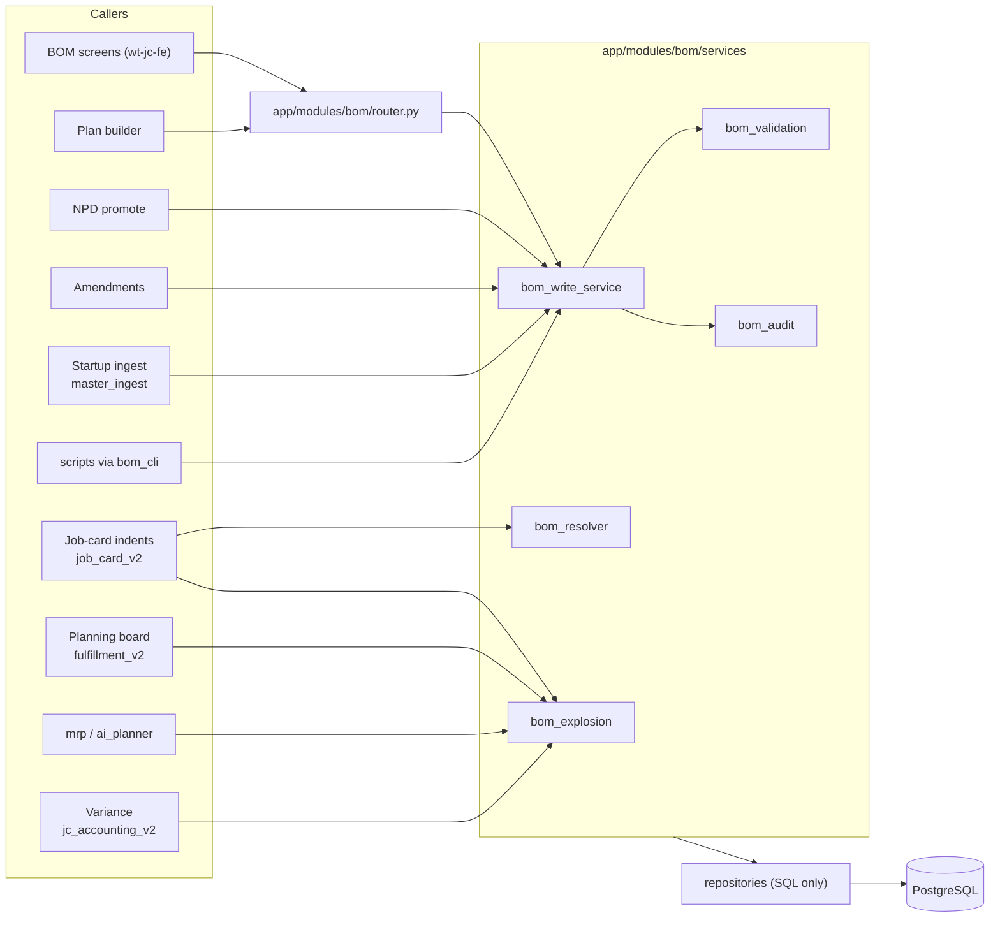
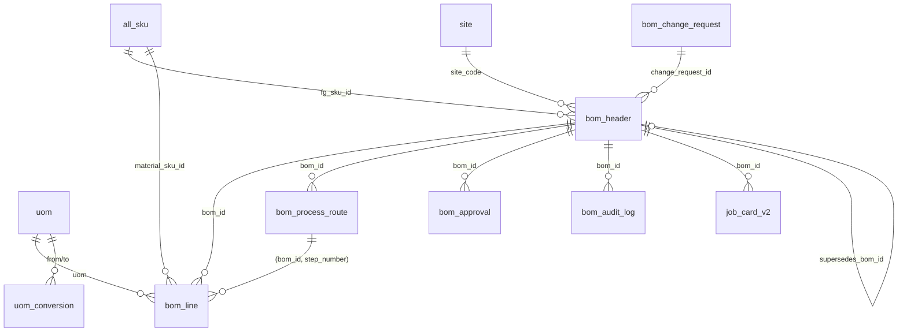

# BOM Module LLD — Candor ERP

Oct 30, 2026 · v0.2 (v0.1 revised against the code at `wt-jc-be` `6c91f04`)

## 0. What changed from v0.1

v0.1 was checked against the code before any migration was written. The design intent is unchanged: one write service, immutable releases, keys instead of names, and one explosion. These were wrong or unsafe in v0.1:
- How migrations and permissions actually work here.
- Columns that v0.1 silently dropped.
- The order of the migration steps.

### 0.1 Revision log

| # | Section | v0.1 said | Problem found in code | v0.2 |
|---|---|---|---|---|
| R1 | §13 | Stepwise migrations M1.1–M2.4 | `scripts/migrate.py` re-executes **every** listed SQL file on every run and keeps no applied-migrations table (`scripts/migrate.py:584-590`) | Every DDL file is re-runnable (guarded `IF NOT EXISTS` / `DO` blocks) and appended to `SQL_FILES`. Backfills are `scripts/apply_bom_*.py`, dry-run by default, run once by the operator |
| R2 | §10 | `INSERT INTO auth_permission (code, description)` | The table is `(module, sub_module, sub_sub_module, action)` (`auth_schema.sql:50-58`). Plain `ON CONFLICT` duplicates NULL rows on every re-run (`095:12-23`) | Seed with the 095 `NOT EXISTS … IS NOT DISTINCT FROM` pattern |
| R3 | §10 | `bom.view.draft`, `bom.view.cost`, `bom.release.qa` as dotted names | Checks fall back from `(module, sub, subsub, action)` to `(module, NULL, NULL, action)` (`permission_service.py:38-44`). As sub-modules, any `bom/view` holder would pass the `view.draft` and `view.cost` checks | Every BOM permission is `('bom', NULL, NULL, <distinct action>)`: `view_draft`, `view_cost`, `release_qa`, … |
| R4 | §10 | Admin bypass disabled only for `release.*` | Admin bypasses in two places: `middleware.py:160-161` and `permission_service.py:29-30`. The FRD says admin holds no BOM write. 095's admin grant is `WHERE p.module = 'bom'` and re-runs every deploy (`095:64-72`), so it would hand admin every new BOM permission | `allow_admin_bypass=False` on every BOM write, change, release and obsolete check. 095's grant narrowed to its own two tuples |
| R5 | §4 | Target `bom_header` lists 22 columns | It drops 14 live columns: `customer_name, pack_size_kg, business_unit, factory, machines, shelf_life_days, gst_rate, hsn_sac, customer_code, output_uom, bar_line_process, promoted_from_gap, bar_line_routed, created_at` (`production_jobcard_slice.sql:215-243`; `058:38-39`; `061:43-44`). This is the G-31 defect in the design itself. `pack_size_kg` feeds expected units (`job_card_v2.py:6405-6419`) and `bar_line_process` feeds `bar_line_service` | All live columns kept. Only M2.4 removes columns, and only once no reader is left |
| R6 | §4 | Route target has `step_no, stage_name, floor, machine_code` | The live columns are `step_number, process_name, stage, std_time_min, loss_pct, qc_check, machine_type` (`production_schema.sql:77-89`) plus `practical_operation, stage_bucket, input/output_kind, input/output_code` (`050:31-36`), which the SFG seam and bar line use | Live columns kept; FKs use `step_number` |
| R7 | §4 | `customer_id INT -- confirm master` | There is no customer master in `app/db`; BOMs carry `customer_name` text | `customer_key TEXT` generated from the normalised `customer_name` ('' = generic). Move to an id when a master exists |
| R8 | §8 | `explode()` reads the component's stock UoM | `all_sku` has no unit code. `all_sku.uom` is `NUMERIC` kg-per-pack (`schema.sql:48-58`) | New `all_sku.stock_uom` backfilled from indent history, with an exceptions report |
| R9 | §4 | UoM codes `KGS, GMS, LTR, PCS, BOX` | Indent tables only accept `KGS, GMS, LTRS, NOS` (RM) and `KGS, NOS, ROLL, SETS, PCS, BUNDLE` (PM) (`017_job_card_v2.sql:218,245`) | `uom` is seeded with exactly those codes plus `PCK` for pack conversion only. `LTR` → `LTRS`. No `BOX` |
| R10 | §4 | `staging_method` CHECK `pick, floor_stock` | The live CHECK and the API also allow `backflush` (`bom_write_service.py:66`) | M0 counts `backflush` rows. Decision D-04 decides map-or-keep before the CHECK changes |
| R11 | §5 | `ex_bom_validity` over released **and obsolete** | Old versions created on the same day share `effective_from = CURRENT_DATE`, so their history can't be backfilled without overlap, and a same-day correction becomes impossible | The exclusion covers `released` only. The resolver breaks ties by `effective_from DESC, version DESC`. A same-day replacement rule is added to the release algorithm |
| R12 | §5 | Drops `uq_bom_header_active_fg` only | `uq_bom_header_fg_version` (`032:58-60`) also blocks multi-site keys. `041` recreates both on every `migrate.py` run when no duplicates exist (`041:133-157`) | Drop both in M1.6, and guard 041 to skip once `bom_header.status` exists |
| R13 | §13 | Guard triggers (M1.5) before writers move (M1.6) | Startup ingest writes BOM tables on every boot (`main.py:123`). Scripts update released rows in place. Rows inserted by old code between M1.2 and M1.6 would leave the new NOT NULL columns empty | A compatibility trigger fills the new columns for legacy writes. Writers and readers move **before** NOT NULL, the `draft` default and the guards |
| R14 | §8 | Synchronous `explode(conn, …)` with per-line `convert()`, `sku_stock_uom()`, `uom_kind()` | asyncpg is async. Three queries per line is N+1 against the 3 s planning-board target. The `dict[item_node_id, qty]` overrides can't express the removed and added rows that `fulfillment_bom_override_v2` holds (`011:55-72`) | Async, preloaded (2 queries per BOM), and an `Override` list type with `removed` and added lines |
| R15 | §8 | Variance baseline = the indent's stored gross | The indent gross is for the **planned** qty. Variance scales by **actual** FG output (`jc_accounting_v2.py:164-184`) | Baseline = `explode(snapshot bom_id, actual output).gross` |
| R16 | §8 | A new snapshot of exploded lines | Indent rows already snapshot `reqd_qty` and `gross_qty` (`017:213-250`), and `reqd_qty > 0` is a CHECK there | Add `item_node_id` and `material_sku_id` to the indent tables. The indent writer skips zero-quantity lines |
| R17 | §11 | `conn.execute("… %s", [key])` | asyncpg uses `$1` and `await`. A `lock_timeout` hit raises `55P03` | asyncpg code; `55P03` → 409 `locked`; `lock_timeout` restored after the lock |
| R18 | §6 | The release refuses when `R.effective_from >= D.effective_from` | Blocks a same-day correction. "Current released R" is ambiguous when a future release exists. There is no backdating rule and no way to cancel a future release | R = released row with the latest `effective_from`. Same-day replacement allowed. `backdated_release` refused (D-06). New `withdrawn` status for a future release cancelled before it starts |
| R19 | §7 | Final approval can be recorded before QA | The FRD order is QA, then plant head | Final approval refused with `qa_pending` until QA has approved. The final-approval body carries `effective_from` |
| R20 | §7, §9 | Only `bom.change` opens a change | FRD §5: planner, R&D and QA raise change requests | `POST /change-requests` with action `request` |
| R21 | §5 | `trg_bom_header_guard` freezes every non-lifecycle column | Classification columns (`process_category`, `bar_line_process`, `bar_line_routed`, …) and route seam codes are edited on live BOMs today (`sync_fg_master.py:264-306`; `seam_mint_service.py:466-478`) | Recipe columns are frozen; listed attribute columns stay editable through an audited `update_attributes` (D-05) |
| R22 | §2, §7 | Package `app/bom/` | The module lives at `app/modules/bom/` | Paths corrected |
| R23 | §9 | Error body `{error, message, line, field}` | The house envelope is `{error, message, details, request_id, timestamp}` (`request_context.py:8-16`) | `line` and `field` go under `details` |
| R24 | §9 | `GET /api/v1/bom` replaces the list | The frontend calls `GET /api/v1/bom/aggregate` (`bom.ts:182-195`) | `/aggregate` kept as an alias until the frontend moves |
| R25 | §4 | FK `bom_line(bom_id, route_step_no) → route` | A draft save deletes and re-inserts the route while lines still point at it | The FK is `DEFERRABLE INITIALLY DEFERRED`; lines are written after the route |
| R26 | §10 | Body entity check by changing the middleware | The middleware serves every module (`middleware.py:163-165`) | `require_entity()` inside the BOM service; the global middleware is untouched |
| R27 | §10 | System actor `system_bom` | `auth_user` needs `phone UNIQUE`, `password_encrypted`, `full_name` (`auth_schema.sql:19-31`) | Seeded with `is_active = FALSE` so it can't log in. Own role, no release actions |
| R28 | §12 | Readers: planning board, JC, MRP, AI planner, variance | v1 readers were missing: `fulfillment.py:671,762`, `job_card_engine.py:178-214`; also `scripts/apply_bar_line_override.py` (route delete+insert) | Added to the integration table |
| R29 | §13 | M2.1 rollback "no data loss" | False once 6-decimal values have been written | Rollback note corrected |
| R30 | §11 | Audit `source TEXT` free | — | `CHECK` on the same list as `bom_header.source` plus `legacy` |
| R31 | §7, §12 | Writer list | Missing writers: POST `/production/routing-gaps/apply` (`production/router.py:9372`, permission production/plans/create) upserts headers and derives routes via `promote_one` (`routing_gap_service.py:354-395`); `scripts/classify_process_categories.py` backfills route categories | Both move onto the service: routing gaps → `create_draft` / change request, gated on `bom/change`; classification → `update_attributes` |
| R32 | §5.4 | Views `v_bom_current`, `v_bom_where_used` | The existing views `sfg_master`, `fg_sfg_binding`, `sfg_where_used` (`055:58-134`) join `bom_header` with no status filter, so drafts and old versions would appear | Those three views are redefined to read released versions valid today (`138`) |
| R33 | §12 | Plan creation resolves the BOM | `create_plan` also accepts a client-supplied `bom_id` (`plan_v2.py:167`) and pins it on the plan line; job cards inherit it (`job_card_v2.py:703-712`) | Accept only the id `bom_resolve` returns for the plan date. Plan-level pinning is a decision (impact map X-01) |

### 0.2 Decisions needed (defaults assumed below)

| # | Decision | Default in this LLD |
|---|---|---|
| D-01 | Customer key | Normalised `customer_name` text until a customer master exists |
| D-02 | Site master | New `site` table seeded from distinct `bom_header.factory`. `warehouse_sites` (site_code, site_name, active) is an external stub for stores sites, not factories, so it is not reused |
| D-03 | Source for `all_sku.stock_uom` | Most frequent UoM in that SKU's indent rows; then by `item_type` (rm → KGS, pm → PCS); the rest go to an exceptions list for MDM |
| D-04 | `backflush` rows | Mapped to `pick`, because no code reads `staging_method` today (fit-gap G-39) |
| D-05 | Editable attributes on released versions | The list in §5.3, audited, under action `change` |
| D-06 | Backdated release | Refused. `effective_from` must be ≥ today |
| D-07 | Future-dated releases and multiple keys per FG during migration | Off until every legacy reader uses `bom_resolve` (end of M1.5) |

## 1. Document control and design principles

| Item | Value |
|---|---|
| Implements | BOM Module FRD (FR-C, FR-CH, FR-D, BR, AC) |
| Stack | PostgreSQL 15+, FastAPI on asyncpg (no ORM), Next.js |
| Code | `app/modules/bom/` (backend), `src/app/modules/bom/` and `src/lib/bom.ts` (frontend) |
| Existing tables reused | `bom_header`, `bom_line`, `bom_process_route`, `all_sku`, `auth_user`, `auth_permission`, `auth_role_permission`, `job_card_v2`, `job_card_rm_indent_v2`, `job_card_pm_indent_v2`, `fulfillment_bom_override_v2`, `job_card_bom_change` |
| Version | 0.2 draft |

### Design principles

1. **One door.** Every BOM write goes through `bom_write_service`. Ingest, scripts, NPD and amendments call it; no module writes BOM tables directly.
2. **Immutable releases.** Lines and recipe columns of a version never change once it leaves draft. Only lifecycle columns and listed attributes move (§5.3).
3. **Keys, not names.** Header and lines reference `all_sku.sku_id`; names are display only.
4. **One explosion.** One async function turns (version, quantity, UoM) into component quantities. Every consumer calls it.
5. **The database enforces.** Keys, validity, ranges, foreign keys and immutability are constraints and triggers.
6. **Expand, migrate, contract.** Add nullable columns, fill them for old and new writers, move the code, then constrain. Old readers keep working throughout.
7. **Re-runnable migrations.** Every SQL file can run again with no effect, because `migrate.py` replays them all.

### Conventions

| Topic | Convention |
|---|---|
| Quantities | `NUMERIC(18,6)` in BOM tables. Indents stay `NUMERIC(15,3)`. Count UoMs round up at indent |
| Percentages | Loss % stored as percent (2.5 = 2.5%). Tolerance stored as a fraction (0.0001) |
| Dates | Validity as `DATE`, inclusive both ends. Timestamps `TIMESTAMPTZ` |
| UoM codes | `KGS, GMS, LTRS, NOS, PCS, ROLL, SETS, BUNDLE` (the indent vocabulary) plus `PCK` |
| Name folding | `bom_norm_key(text)` = lower, NBSP → space, collapse whitespace, trim. The same fold as `bom_write_service._NORM_FG_SQL` (`:136-139`) |
| Actors | `auth_user.user_id`. Seeded inactive users `system_bom` (ingest, scripts) and `migration` |
| Permissions | `('bom', NULL, NULL, <action>)` tuples only |
| Migrations | `app/db/NNN_*.sql`, idempotent, appended to `scripts/migrate.py` `SQL_FILES`. Backfills in `scripts/apply_bom_*.py` (dry run unless `--apply`). Applied to RDS by the operator |
| Errors | House envelope. Services raise `BomError` subclasses, never `HTTPException` |

## 2. Architecture



Screens call the REST API. Backend modules import the service in-process, so permission and entity checks run inside the service as well as in the router.

## 3. Database architecture



| From table | Column(s) | References | On delete |
|---|---|---|---|
| `bom_header` | `fg_sku_id` | `all_sku.sku_id` | Restrict |
| `bom_header` | `site_code` | `site.site_code` | Restrict |
| `bom_header` | `base_uom` | `uom.code` | Restrict |
| `bom_header` | `change_request_id` | `bom_change_request` | Restrict |
| `bom_header` | `supersedes_bom_id` | `bom_header.bom_id` | Restrict |
| `bom_header` | `created_by`, `submitted_by`, `released_by` | `auth_user.user_id` | Restrict |
| `bom_line` | `bom_id` | `bom_header.bom_id` | Restrict (no deletes; drafts are discarded by status) |
| `bom_line` | `material_sku_id` | `all_sku.sku_id` | Restrict |
| `bom_line` | `uom` | `uom.code` | Restrict (after M1.3 rewrites values to codes) |
| `bom_line` | `(bom_id, route_step_no)` | `bom_process_route (bom_id, step_number)` | Restrict, `DEFERRABLE INITIALLY DEFERRED` |
| `bom_process_route` | `bom_id` | `bom_header.bom_id` | Restrict |
| `bom_approval` | `bom_id`, `approver_id` | `bom_header`, `auth_user` | Restrict |
| `bom_audit_log` | `bom_id`, `actor_user_id` | `bom_header`, `auth_user` | Restrict |
| `bom_change_request` | `fg_sku_id`, `site_code`, `source_bom_id`, `target_bom_id`, `requested_by` | `all_sku`, `site`, `bom_header`, `auth_user` | Restrict |
| `uom_conversion` | `sku_id`, `from_uom`, `to_uom` | `all_sku`, `uom` | Restrict |
| `all_sku` | `stock_uom` | `uom.code` | Restrict |
| `job_card_v2` (existing) | `bom_id` | `bom_header.bom_id` | Restrict |

## 4. Table definitions

Three existing BOM tables are extended, seven tables are new, and `all_sku` plus the two indent tables gain columns. Everything below is written as re-runnable DDL and split by the migration file that carries it (§13).

| Table | New / existing | Purpose | Approx. rows |
|---|---|---|---|
| `uom` | New | Unit master: kind and decimals | ~10 |
| `uom_conversion` | New | Global and per-SKU factors, including the pack factor | ~500 |
| `site` | New (D-02) | Factory per entity | < 10 |
| `bom_change_request` | New | Why a version exists and the requested date | 1 per version > 1 |
| `bom_header` | Existing, extended | One row per version | ~1,900 today |
| `bom_line` | Existing, extended | Components per version | 10–40 per version |
| `bom_process_route` | Existing, extended | Steps per version | 3–8 per version |
| `bom_approval` | New | QA and final decisions | 2+ per released version |
| `bom_audit_log` | New | Append-only change log | grows |
| `bom_export_log` | New | Exports | small |
| `all_sku`, `job_card_rm_indent_v2`, `job_card_pm_indent_v2` | Existing | `stock_uom`; snapshot keys | — |

### 4.1 Masters and change control (`134_bom_masters.sql`)

```sql
CREATE EXTENSION IF NOT EXISTS btree_gist;

-- One name fold for SKU names and customer names. IMMUTABLE: used in a generated column; never redefine.
CREATE OR REPLACE FUNCTION bom_norm_key(p TEXT) RETURNS TEXT
LANGUAGE sql IMMUTABLE PARALLEL SAFE AS $$
  SELECT COALESCE(btrim(regexp_replace(replace(lower(p), chr(160), ' '), '\s+', ' ', 'g')), '')
$$;
CREATE INDEX IF NOT EXISTS ix_all_sku_norm ON all_sku (bom_norm_key(particulars));

CREATE TABLE IF NOT EXISTS uom (
  code        TEXT PRIMARY KEY,
  kind        TEXT NOT NULL CHECK (kind IN ('mass','volume','count')),
  decimals    SMALLINT NOT NULL DEFAULT 3 CHECK (decimals BETWEEN 0 AND 6),   -- 0 = round up at indent
  description TEXT
);
INSERT INTO uom (code, kind, decimals, description) VALUES
  ('KGS','mass',3,'Kilogram'), ('GMS','mass',3,'Gram'), ('LTRS','volume',3,'Litre'),
  ('NOS','count',0,'Numbers'), ('PCS','count',0,'Pieces'), ('ROLL','count',0,'Roll'),
  ('SETS','count',0,'Set'), ('BUNDLE','count',0,'Bundle'),
  ('PCK','count',0,'FG pack; used only in pack-to-base conversions')
ON CONFLICT (code) DO NOTHING;

CREATE TABLE IF NOT EXISTS uom_conversion (
  conversion_id BIGSERIAL PRIMARY KEY,
  sku_id    INT REFERENCES all_sku(sku_id),                 -- NULL = global
  from_uom  TEXT NOT NULL REFERENCES uom(code),
  to_uom    TEXT NOT NULL REFERENCES uom(code),
  factor    NUMERIC(18,9) NOT NULL CHECK (factor > 0),      -- qty_to = qty_from * factor
  CHECK (from_uom <> to_uom)
);
CREATE UNIQUE INDEX IF NOT EXISTS uq_uom_conversion ON uom_conversion ((COALESCE(sku_id, 0)), from_uom, to_uom);
INSERT INTO uom_conversion (sku_id, from_uom, to_uom, factor) VALUES
  (NULL,'GMS','KGS',0.001), (NULL,'KGS','GMS',1000)
ON CONFLICT ((COALESCE(sku_id, 0)), from_uom, to_uom) DO NOTHING;
-- Per-SKU PCK -> KGS rows (factor = all_sku.uom) are written by scripts/apply_bom_backfill.py.

ALTER TABLE all_sku ADD COLUMN IF NOT EXISTS stock_uom TEXT REFERENCES uom(code);   -- D-03 backfill

CREATE TABLE IF NOT EXISTS site (
  site_code TEXT PRIMARY KEY,
  entity    TEXT NOT NULL CHECK (entity IN ('cfpl','cdpl')),
  name      TEXT NOT NULL,
  is_active BOOLEAN NOT NULL DEFAULT TRUE
);

CREATE SEQUENCE IF NOT EXISTS bom_item_node_seq;

CREATE TABLE IF NOT EXISTS bom_change_request (
  change_request_id BIGINT GENERATED ALWAYS AS IDENTITY PRIMARY KEY,
  fg_sku_id     INT NOT NULL REFERENCES all_sku(sku_id),
  site_code     TEXT NOT NULL REFERENCES site(site_code),
  customer_name TEXT,
  customer_key  TEXT GENERATED ALWAYS AS (bom_norm_key(customer_name)) STORED,
  alternative   SMALLINT NOT NULL DEFAULT 1 CHECK (alternative BETWEEN 1 AND 99),
  change_type   TEXT NOT NULL CHECK (change_type IN
                ('new_bom','formulation','packaging','routing','correction','obsolete')),
  reason        TEXT NOT NULL CHECK (length(reason) BETWEEN 10 AND 2000),
  requested_effective_from DATE NOT NULL,
  source_bom_id INT,                -- FK added in 135 (bom_header gains columns there)
  target_bom_id INT,
  status        TEXT NOT NULL DEFAULT 'open' CHECK (status IN
                ('open','in_progress','in_review','released','rejected','cancelled')),
  requested_by  INT NOT NULL REFERENCES auth_user(user_id),
  requested_at  TIMESTAMPTZ NOT NULL DEFAULT now(),
  closed_at     TIMESTAMPTZ,
  legacy_amendment_id BIGINT        -- bom_amendment_request_v2.request_id when migrated from there
);
CREATE INDEX IF NOT EXISTS ix_bom_cr_key ON bom_change_request (fg_sku_id, site_code, customer_key, alternative, status);

CREATE TABLE IF NOT EXISTS bom_approval (
  approval_id BIGINT GENERATED ALWAYS AS IDENTITY PRIMARY KEY,
  bom_id      INT NOT NULL REFERENCES bom_header(bom_id),
  step        TEXT NOT NULL CHECK (step IN ('qa','final')),
  decision    TEXT NOT NULL CHECK (decision IN ('approved','rejected')),
  approver_id INT NOT NULL REFERENCES auth_user(user_id),
  comment     TEXT CHECK (length(comment) <= 2000),
  decided_at  TIMESTAMPTZ NOT NULL DEFAULT now()
);
CREATE UNIQUE INDEX IF NOT EXISTS uq_bom_approval_step ON bom_approval (bom_id, step) WHERE decision = 'approved';

CREATE TABLE IF NOT EXISTS bom_audit_log (
  audit_id      BIGINT GENERATED ALWAYS AS IDENTITY PRIMARY KEY,
  bom_id        INT NOT NULL REFERENCES bom_header(bom_id),
  bom_line_id   INT,
  item_node_id  BIGINT,
  entity_table  TEXT NOT NULL CHECK (entity_table IN ('bom_header','bom_line','bom_process_route','bom_approval')),
  action        TEXT NOT NULL CHECK (action IN ('create','update','delete','submit','approve','reject',
                'release','obsolete','withdraw','discard','attribute_update')),
  field         TEXT,
  old_value     JSONB,
  new_value     JSONB,
  actor_user_id INT REFERENCES auth_user(user_id),
  source        TEXT NOT NULL CHECK (source IN ('bom_api','npd_promote','amendment','ingest','script','migration','legacy')),
  change_request_id BIGINT,
  request_id    TEXT,
  at            TIMESTAMPTZ NOT NULL DEFAULT now()
);
CREATE INDEX IF NOT EXISTS ix_bom_audit_bom_at   ON bom_audit_log (bom_id, at DESC);
CREATE INDEX IF NOT EXISTS ix_bom_audit_actor_at ON bom_audit_log (actor_user_id, at DESC);
CREATE INDEX IF NOT EXISTS ix_bom_audit_src_at   ON bom_audit_log (source, at DESC);

CREATE TABLE IF NOT EXISTS bom_export_log (
  export_id BIGINT GENERATED ALWAYS AS IDENTITY PRIMARY KEY,
  user_id   INT NOT NULL REFERENCES auth_user(user_id),
  scope     JSONB NOT NULL,
  row_count INT NOT NULL,
  at        TIMESTAMPTZ NOT NULL DEFAULT now()
);
```

### 4.2 Expansion of existing tables (`135_bom_expand.sql`, all columns nullable)

Every live column stays. Only the additions are listed.

```sql
ALTER TABLE bom_header
  ADD COLUMN IF NOT EXISTS fg_sku_id        INT REFERENCES all_sku(sku_id),
  ADD COLUMN IF NOT EXISTS site_code        TEXT REFERENCES site(site_code),
  ADD COLUMN IF NOT EXISTS customer_key     TEXT GENERATED ALWAYS AS (bom_norm_key(customer_name)) STORED,
  ADD COLUMN IF NOT EXISTS alternative      SMALLINT NOT NULL DEFAULT 1,
  ADD COLUMN IF NOT EXISTS status           TEXT,
  ADD COLUMN IF NOT EXISTS base_qty         NUMERIC(18,6) NOT NULL DEFAULT 1,
  ADD COLUMN IF NOT EXISTS base_uom         TEXT REFERENCES uom(code),
  ADD COLUMN IF NOT EXISTS change_request_id BIGINT REFERENCES bom_change_request(change_request_id),
  ADD COLUMN IF NOT EXISTS supersedes_bom_id INT REFERENCES bom_header(bom_id),
  ADD COLUMN IF NOT EXISTS source           TEXT,
  ADD COLUMN IF NOT EXISTS lock_version     INT NOT NULL DEFAULT 0,
  ADD COLUMN IF NOT EXISTS version_legacy   INT,
  ADD COLUMN IF NOT EXISTS created_by       INT REFERENCES auth_user(user_id),
  ADD COLUMN IF NOT EXISTS updated_at       TIMESTAMPTZ,
  ADD COLUMN IF NOT EXISTS submitted_by     INT REFERENCES auth_user(user_id),
  ADD COLUMN IF NOT EXISTS submitted_at     TIMESTAMPTZ,
  ADD COLUMN IF NOT EXISTS released_by      INT REFERENCES auth_user(user_id),
  ADD COLUMN IF NOT EXISTS released_at      TIMESTAMPTZ,
  ADD COLUMN IF NOT EXISTS obsoleted_at     TIMESTAMPTZ;
ALTER TABLE bom_header ALTER COLUMN allowed_balance_tolerance_pct SET DEFAULT 0.0001;   -- live value, FRD FR-C-13

ALTER TABLE bom_line
  ADD COLUMN IF NOT EXISTS item_node_id     BIGINT,
  ADD COLUMN IF NOT EXISTS material_sku_id  INT REFERENCES all_sku(sku_id),
  ADD COLUMN IF NOT EXISTS fixed_qty        BOOLEAN NOT NULL DEFAULT FALSE,
  ADD COLUMN IF NOT EXISTS provision        TEXT NOT NULL DEFAULT 'own',
  ADD COLUMN IF NOT EXISTS route_step_no    INT,
  ADD COLUMN IF NOT EXISTS alt_group        SMALLINT,          -- Phase 2, Q-08
  ADD COLUMN IF NOT EXISTS alt_priority     SMALLINT,
  ADD COLUMN IF NOT EXISTS alt_share_pct    NUMERIC(5,2);

ALTER TABLE job_card_rm_indent_v2
  ADD COLUMN IF NOT EXISTS item_node_id BIGINT, ADD COLUMN IF NOT EXISTS material_sku_id INT;
ALTER TABLE job_card_pm_indent_v2
  ADD COLUMN IF NOT EXISTS item_node_id BIGINT, ADD COLUMN IF NOT EXISTS material_sku_id INT;

DO $$ BEGIN
  IF NOT EXISTS (SELECT 1 FROM pg_constraint WHERE conname = 'fk_bom_cr_source') THEN
    ALTER TABLE bom_change_request
      ADD CONSTRAINT fk_bom_cr_source FOREIGN KEY (source_bom_id) REFERENCES bom_header(bom_id),
      ADD CONSTRAINT fk_bom_cr_target FOREIGN KEY (target_bom_id) REFERENCES bom_header(bom_id);
  END IF;
END $$;
```

### 4.3 Target shape after M1.6 (constraints added in `136`, tightened in `138`)

| Table | Column | Final rule |
|---|---|---|
| `bom_header` | `fg_sku_id`, `site_code`, `status`, `source`, `created_by`, `entity`, `effective_from`, `base_uom` | `NOT NULL` |
| `bom_header` | `status` | `CHECK IN ('draft','in_review','released','withdrawn','obsolete','discarded')`, default `'draft'` |
| `bom_header` | `source` | `CHECK IN ('bom_api','npd_promote','amendment','ingest','script','migration','legacy')` |
| `bom_header` | `alternative` | `CHECK BETWEEN 1 AND 99` |
| `bom_header` | `base_qty` | `CHECK > 0` |
| `bom_header` | `effective_to` | `CHECK (effective_to IS NULL OR effective_to >= effective_from)` |
| `bom_header` | `allowed_balance_tolerance_pct` | `CHECK (> 0 AND < 1)`; type stays `NUMERIC(5,4)` (0.0001 fits) |
| `bom_header` | `notes` | `CHECK (length(notes) <= 2000)`, added `NOT VALID` and validated after trimming |
| `bom_header` | rule | `CHECK (version = 1 OR change_request_id IS NOT NULL OR source IN ('migration','ingest','legacy'))` |
| `bom_header` | rule | `CHECK (status NOT IN ('released','obsolete') OR (released_at IS NOT NULL OR source IN ('migration','legacy')))` |
| `bom_line` | `material_sku_id`, `item_node_id`, `uom` | `NOT NULL`; `uom` FK to `uom` |
| `bom_line` | `item_type` | `CHECK IN ('rm','pm','sfg')` |
| `bom_line` | `quantity_per_unit` | `CHECK > 0`; `NUMERIC(18,6)` in M2.1 |
| `bom_line` | `loss_pct` | `CHECK (>= 0 AND < 100)`; type stays `NUMERIC(5,3)` |
| `bom_line` | `provision` | `CHECK IN ('own','customer')` |
| `bom_line` | `staging_method` | `CHECK IN ('pick','floor_stock')` after D-04 mapping (today also `backflush`) |
| `bom_line` | `alt_share_pct` | `CHECK BETWEEN 0 AND 100` |
| `bom_line` | uniqueness | `UNIQUE (bom_id, line_number)` (exists), `UNIQUE (bom_id, item_node_id)` |
| `bom_process_route` | `loss_pct` | `CHECK (>= 0 AND < 100)` |
| `bom_process_route` | uniqueness | `UNIQUE (bom_id, step_number)` (exists) |

## 5. Constraints, indexes, triggers and functions

### 5.1 Constraints and indexes (`136_bom_constraints.sql`, guarded `DO` blocks; FKs `NOT VALID` then `VALIDATE`)

```sql
-- version per logical key
CREATE UNIQUE INDEX IF NOT EXISTS uq_bom_key_version
  ON bom_header (fg_sku_id, site_code, customer_key, alternative, version);

-- one open draft per key
CREATE UNIQUE INDEX IF NOT EXISTS uq_bom_one_open_draft
  ON bom_header (fg_sku_id, site_code, customer_key, alternative)
  WHERE status IN ('draft','in_review');

-- released versions of one key never overlap (obsolete history may: same-day replacements)
DO $$ BEGIN
  IF NOT EXISTS (SELECT 1 FROM pg_constraint WHERE conname = 'ex_bom_validity') THEN
    ALTER TABLE bom_header ADD CONSTRAINT ex_bom_validity EXCLUDE USING gist (
      fg_sku_id WITH =, site_code WITH =, customer_key WITH =, alternative WITH =,
      daterange(effective_from, effective_to, '[]') WITH &&
    ) WHERE (status = 'released');
  END IF;
END $$;

-- route-step link, deferrable so a draft can rewrite its route inside one transaction
DO $$ BEGIN
  IF NOT EXISTS (SELECT 1 FROM pg_constraint WHERE conname = 'fk_bom_line_route_step') THEN
    ALTER TABLE bom_line ADD CONSTRAINT fk_bom_line_route_step
      FOREIGN KEY (bom_id, route_step_no) REFERENCES bom_process_route (bom_id, step_number)
      DEFERRABLE INITIALLY DEFERRED NOT VALID;
  END IF;
END $$;

CREATE INDEX IF NOT EXISTS ix_bom_header_resolve ON bom_header
  (fg_sku_id, site_code, customer_key, alternative, effective_from DESC) WHERE status IN ('released','obsolete');
CREATE INDEX IF NOT EXISTS ix_bom_header_open     ON bom_header (status) WHERE status IN ('draft','in_review');
CREATE INDEX IF NOT EXISTS ix_bom_line_material   ON bom_line (material_sku_id);   -- where-used
CREATE INDEX IF NOT EXISTS ix_bom_line_node       ON bom_line (item_node_id);      -- line history
-- ix on bom_line(bom_id) and bom_process_route(bom_id) already exist (production_schema.sql:74,91)
```

The old indexes `uq_bom_header_active_fg` and `uq_bom_header_fg_version` (`032:39-41, 58-60`) are dropped in **M1.6**, after every writer has moved. In the same release `041_reconcile_orphaned_unique_indexes.sql` gains a guard, so `migrate.py` stops recreating them:

```sql
-- in 041, before the bom_header block
IF EXISTS (SELECT 1 FROM information_schema.columns
            WHERE table_name = 'bom_header' AND column_name = 'status') THEN
  RAISE NOTICE 'bom_header uses versioned keys — legacy name indexes not recreated'; RETURN;
END IF;
```

### 5.2 Triggers

Trigger names carry a number because Postgres fires same-event triggers in name order.

| Trigger | Table | Fires | Does | Created / removed |
|---|---|---|---|---|
| `trg_bom_10_legacy_fill` | `bom_header` | BEFORE INSERT OR UPDATE | Rows written by pre-service code (`source IS NULL` or `'legacy'`) get `source = 'legacy'`, `status` from `is_active`, `effective_from` defaulted, and `fg_sku_id` looked up by `bom_norm_key`. An UPDATE that clears `is_active` closes the row (`status = 'obsolete'`, `effective_to = GREATEST(effective_from, CURRENT_DATE - 1)`) | 135 / dropped in 138 |
| `trg_bom_20_sync_active` | `bom_header` | BEFORE INSERT OR UPDATE | `is_active := (status = 'released')` | 136, until M2.4 |
| `trg_bom_30_status_flow` | `bom_header` | BEFORE UPDATE OF status | Allows draft→in_review, in_review→draft, in_review→released, released→obsolete, released→withdrawn (only if `effective_from > CURRENT_DATE`), draft→discarded. Raises `bad_status_transition` otherwise | 136 |
| `trg_bom_40_header_guard` | `bom_header` | BEFORE UPDATE | §5.3 rules; raises `bom_version_immutable` | 138 |
| `trg_bom_line_guard`, `trg_bom_route_guard` | `bom_line`, `bom_process_route` | BEFORE INSERT/UPDATE/DELETE | Parent must be `draft`. Released route rows allow UPDATE of attribute columns only (§5.3) | 138 |
| `trg_bom_line_not_header` | `bom_line` | BEFORE INSERT OR UPDATE | Raises `recursive_bom` when `material_sku_id` = header `fg_sku_id` | 136 |
| `trg_bom_audit_backstop` | header, line, route | AFTER INSERT/UPDATE/DELETE | Writes a coarse audit row (full old/new JSONB) when `current_setting('app.audit_written', true)` is not `'on'`. Actor from `app.user_id`, source from `app.source`, else `'legacy'` | 136 |
| `trg_bom_audit_append_only` | `bom_audit_log` | BEFORE UPDATE OR DELETE | Always raises. Plus `REVOKE UPDATE, DELETE ON bom_audit_log` from the app role | 136 |

Indirect recursion (FRD BR-11) needs no trigger: SFG lines are never exploded into their own BOMs (BR-08), so only the direct case can occur.

### 5.3 Immutability rules

| Header state | May change |
|---|---|
| `draft` | Anything |
| `in_review` | Lifecycle columns + `effective_from` (set by the final approval) |
| `released`, `withdrawn`, `obsolete`, `discarded` | Lifecycle columns + attribute columns |

- **Lifecycle columns:** `status, effective_to, obsoleted_at, submitted_by, submitted_at, released_by, released_at, is_active, updated_at, lock_version`.
- **Header attribute columns (D-05):** `item_group, sub_group, process_category, business_unit, inventory_group, factory, floors, machines, shelf_life_days, gst_rate, hsn_sac, customer_code, bar_line_process, bar_line_routed, promoted_from_gap, notes`.
- **Recipe columns (frozen once the version leaves draft):** everything else, including `fg_sku_id, site_code, customer_name, alternative, version, entity, base_qty, base_uom, pack_size_kg, output_uom, effective_from, allowed_balance_tolerance_pct, change_request_id, supersedes_bom_id`, plus all of `bom_line` and route `step_number, process_name, stage, loss_pct`.
- **Route attribute columns (released rows, UPDATE only):** `practical_operation, stage_bucket, input_kind, output_kind, input_code, output_code, machine_type, qc_check, std_time_min`. These cover the SFG seam mint. A bar-line override deletes and re-inserts steps, so it becomes a change request.

The guard compares rows as JSONB minus the allowed columns, so a column added later is frozen by default:

```sql
CREATE OR REPLACE FUNCTION bom_header_guard() RETURNS trigger LANGUAGE plpgsql AS $$
DECLARE
  lifecycle  TEXT[] := ARRAY['status','effective_to','obsoleted_at','submitted_by','submitted_at',
                             'released_by','released_at','is_active','updated_at','lock_version'];
  attributes TEXT[] := ARRAY['item_group','sub_group','process_category','business_unit','inventory_group',
                             'factory','floors','machines','shelf_life_days','gst_rate','hsn_sac',
                             'customer_code','bar_line_process','bar_line_routed','promoted_from_gap','notes'];
  allowed    TEXT[];
BEGIN
  IF OLD.status = 'draft' THEN RETURN NEW; END IF;
  allowed := CASE WHEN OLD.status = 'in_review' THEN lifecycle || ARRAY['effective_from']
                  ELSE lifecycle || attributes END;
  IF (to_jsonb(NEW) - allowed) IS DISTINCT FROM (to_jsonb(OLD) - allowed) THEN
    RAISE EXCEPTION 'bom_version_immutable' USING ERRCODE = 'P0001';
  END IF;
  RETURN NEW;
END $$;
```

### 5.4 Functions and views

| Object | Returns | Used by |
|---|---|---|
| `bom_norm_key(text)` | Folded name | Generated `customer_key`, SKU lookup in the compatibility trigger and backfill |
| `bom_resolve(fg_sku_id, site_code, customer_name, alternative, on_date)` | The `bom_id` valid on that date, customer-specific before generic | Explosion, display, job-card creation |
| `v_bom_current` | Released versions valid today with FG code, name and site | List screen, planning board |
| `v_bom_where_used` | Component → parent FG, version, quantity, validity | Where-used |
| `v_bom_line_history` | Every version of each `item_node_id` with quantity, UoM, loss and dates | Line history, compare |

## 6. Versioning and effectivity

| Concept | Column | Rule |
|---|---|---|
| BOM key | `fg_sku_id, site_code, customer_key, alternative` | One logical BOM |
| Version | `version` | max + 1 per key inside the locked transaction. The pre-migration number is kept in `version_legacy` |
| Validity | `effective_from`, `effective_to` | Inclusive. NULL end = open. Only `released` rows are overlap-checked |
| Line identity | `item_node_id` | Copied into each new version; a new line gets `nextval('bom_item_node_seq')` |
| Lineage | `supersedes_bom_id` | The released version a draft was copied from |
| Reason | `change_request_id` | Mandatory for version > 1, except migration, ingest and legacy rows |

### Release algorithm (run by the final approval)

1. Lock the key (§11) and load draft D: status `in_review`, QA approved, otherwise `qa_pending`.
2. E = the final approval's `effective_from`, defaulting to `D.effective_from`. If E < today, refuse `backdated_release` (D-06).
3. R = the `released` row of the key with the latest `effective_from`, if any.
   - E < `R.effective_from`: refuse `validity_overlap` (withdraw the later release first).
   - E = `R.effective_from` (same-day replacement): `R.status = 'obsolete'`, `R.effective_to = R.effective_from`, `R.obsoleted_at = now()`.
   - E > `R.effective_from` and R is open-ended or ends on or after E: `R.effective_to = E − 1`. If that is before today, R also becomes `obsolete`.
4. D: `status = 'released'`, `effective_from = E`, `released_by/at` set. Close the change request.
5. Write audit rows for D and R; commit. `ex_bom_validity` rejects anything steps 3–4 missed.

**Withdraw** a future release F (only while `F.effective_from > today`):
- F becomes `withdrawn`.
- The previous version's `effective_to` goes back to what it was before F's release, read from the audit row.

**Obsolete** a key with no successor: set `effective_to ≥ today` on R.

**Nightly status job.** Moving released rows whose `effective_to` has passed to `obsolete` is cosmetic, because resolution filters by date. No scheduler was found in the code, so `v_bom_current` and the list screen compute the displayed status at read time instead.

### Resolver

```sql
CREATE OR REPLACE FUNCTION bom_resolve(
  p_fg_sku_id INT, p_site TEXT, p_customer_name TEXT, p_alt SMALLINT, p_on DATE
) RETURNS INT LANGUAGE sql STABLE AS $$
  SELECT h.bom_id
    FROM bom_header h
   WHERE h.fg_sku_id   = p_fg_sku_id
     AND h.site_code   = p_site
     AND h.alternative = COALESCE(p_alt, 1)
     AND h.customer_key IN (bom_norm_key(p_customer_name), '')
     AND h.status IN ('released','obsolete')
     AND p_on >= h.effective_from
     AND (h.effective_to IS NULL OR p_on <= h.effective_to)
   ORDER BY (h.customer_key = bom_norm_key(p_customer_name)) DESC,   -- customer-specific first
            h.effective_from DESC, h.version DESC                     -- same-day replacement wins
   LIMIT 1
$$;
```

### Example timeline

| bom_id | version | status | effective_from | effective_to | CR | Note |
|---|---|---|---|---|---|---|
| 101 | 1 | obsolete | 2026-04-01 | 2026-11-30 | — | Migrated |
| 214 | 2 | obsolete | 2026-12-01 | 2026-12-01 | 57 | RM-101 250 → 240 kg |
| 219 | 3 | released | 2026-12-01 | NULL | 58 | Same-day correction of v2 |
| 233 | 4 | in_review | 2027-01-01 | NULL | 63 | Replace RM-103 with RM-105 |

- On 2026-11-20 the resolver returns 101.
- On 2026-12-01 it returns 219: 214 and 219 overlap on that day, and the higher version wins.
- 233 is never returned until it is released.
- Job cards created on 2026-12-01 before 219 existed keep 214.

## 7. Service layer

```
app/modules/bom/
  router.py              thin routes, response_model + status_code
  schemas.py             Pydantic: BomCreate, BomUpdate, AttributesUpdate, BomRead, BomLineRead,
                         BomLineCostRead, ChangeRequestCreate/Read, ApproveIn, RejectIn, ObsoleteIn,
                         ExplodeQuery, ExplosionRead, CompareRead, WhereUsedRead, AuditRead, BomFilter
  errors.py              BomError(code, http_status, message, details) and subclasses
  authz.py               ensure(conn, user, action, *, allow_admin_bypass), require_entity(user, entity)
  repositories/          bom_repo.py, uom_repo.py, change_request_repo.py, audit_repo.py
                         (SQL only; take a conn; never open or commit a transaction)
  services/
    bom_write_service.py     every create / change / lifecycle operation; owns the transaction
    bom_validation.py        errors + warnings; dry run
    bom_resolver.py          resolve(key, date), get_version(bom_id), resolve_sku(name | id)
    bom_explosion.py         explode() (section 8)
    bom_audit.py             set_actor(), diff_and_log()
    bom_aggregate_service.py existing list/detail reads, extended with status/date/entity filters
```

Each write runs in one transaction inside the service:
1. `set_actor` runs `set_config('app.user_id', …, true)`, plus `app.source`, `app.request_id` and `app.audit_written`.
2. Authorization and entity checks.
3. Lock the key.
4. Load.
5. Validate.
6. Mutate.
7. Audit.
8. Commit.

Notifications to QA, the plant head and the owner are sent after commit and never roll the write back. The transaction moves out of the router, where it sits today (`bom/router.py:174-176`).

| Operation | Action checked | Steps |
|---|---|---|
| `raise_change_request` | `request` | Validate key and reason → insert CR (open) → audit |
| `create_draft` | `create` | Resolve SKUs by id → validate → lock key → refuse `bom_exists` if a draft or released row exists → version = max + 1 → insert header (draft), route, then lines with new item nodes → audit |
| `open_change` | `change` | Lock → refuse `draft_exists` → load released R → copy **every** header column, route row and line column into draft v+1 with `supersedes_bom_id = R`, keeping `item_node_id` → link CR (`in_progress`) → audit |
| `update_draft` | `change` | Lock → `If-Match` = `lock_version`, else `stale_draft` → validate → rewrite route, then lines (deferred FK) → bump `lock_version` → audit diff by `item_node_id` |
| `update_attributes` | `change` | Released versions only; attribute columns only (§5.3) → audit `attribute_update` |
| `submit` | `change` | draft → in_review; full validation again; `submitted_by/at` |
| `approve(qa)` | `release_qa` | in_review; approver ≠ `created_by` → insert approval |
| `approve(final)` | `release_final` | QA approved, else `qa_pending`; approver ≠ `created_by` and ≠ QA approver → insert approval → release algorithm (§6) |
| `reject(step)` | `release_qa` or `release_final` | Insert rejection → in_review → draft → audit |
| `withdraw` | `obsolete` | Future release only (§6) |
| `obsolete` | `obsolete` | Set `effective_to ≥ today` on R → audit |
| `discard` | `change` | draft → discarded; CR cancelled |

Every service operation re-checks its action through `authz.ensure`, because NPD, ingest and scripts call the service without the router. Database errors are mapped in one place:

| Postgres error | Code returned |
|---|---|
| `P0001` with message `bom_version_immutable` | 409 `bom_version_immutable` |
| `P0001` with message `recursive_bom` | 400 `recursive_bom` |
| `P0001` with message `bad_status_transition` | 409 `bad_status_transition` |
| `23P01` | 409 `validity_overlap` |
| `23505` on `uq_bom_one_open_draft` | 409 `draft_exists` |
| `23505` on `uq_bom_key_version` | 409 `bom_exists` |
| `55P03` | 409 `locked` |

### Callers moved onto the service

| Today's writer | New call | Source |
|---|---|---|
| `POST /api/v1/bom` (`bom/router.py:156`) | `create_draft` | `bom_api` |
| `POST /plans-v2/bom` (`plan_v2.py:292-353`) | Phase 0: 409 if any active BOM, permission `('bom',…,'create')`. Phase 1: `create_draft` | `bom_api` |
| Amendment approve (`amendments_v2.py:710-861`) | Phase 0: copy every column and the route; refuse lines outside the source BOM. Phase 1: `open_change` → `update_draft` → `submit` | `amendment` |
| NPD draft and dev promote (`npd_service.py:115-184`, `npd_dev_service.py:858-884`) | `create_draft` or `open_change`; release still needs QA and the plant head | `npd_promote` |
| Startup ingest (`master_ingest.py:1493-1655`, run at `main.py:123`) | `create_draft` / `open_change` as `system_bom`; unmatched SKUs reported, not inserted | `ingest` |
| `bar_line_service.py:190-206`, `scripts/apply_bar_line_override.py` | Change request + `open_change` (route delete+insert) | `script` |
| `seam_mint_service.py:466-478` | `update_attributes` on route codes | `script` |
| `scripts/sync_fg_master.py`, `promote_fg_master_gaps.py` | `update_attributes` (classification) or `create_draft` (new FG), via the `bom_cli` wrapper requiring `--reason` | `script` |
| `scripts/apply_bom_balance_tolerance.py` | Retire. Tolerance is a recipe column and changes only through a new version | — |

## 8. Explosion helper

`explode()` is the only place a component quantity is computed. For 2,500 kg against a 1,000 kg base, a 250 kg line with 2% loss gives net 625.000 and gross 637.755 kg, on every screen and at any pack size.

```python
@dataclass(frozen=True)
class Override:                      # built by callers from fulfillment_bom_override_v2 rows
    item_node_id: int | None         # None = line added for this order
    material_sku_id: int | None
    qty: Decimal | None              # per base qty; None = keep the BOM value; 0 is a real value
    uom: str | None
    loss_pct: Decimal | None
    removed: bool = False

@dataclass(frozen=True)
class ExplodedLine:
    bom_line_id: int | None; item_node_id: int | None; material_sku_id: int; item_type: str
    uom: str; net_qty: Decimal; gross_qty: Decimal; loss_pct: Decimal
    indent: bool; provision: str

async def explode(conn, bom_id: int, order_qty: Decimal, order_uom: str, *,
                  overrides: Sequence[Override] = ()) -> list[ExplodedLine]:
    h = await bom_repo.get_header(conn, bom_id)
    if h.status not in ("released", "obsolete"):
        raise BomNotUsable(bom_id)                                   # drafts never explode (BR-13)
    lines = await bom_repo.get_lines(conn, bom_id)                   # query 1
    skus = {h.fg_sku_id, *(l.material_sku_id for l in lines),
            *(o.material_sku_id for o in overrides if o.material_sku_id)}
    units = await uom_repo.load(conn, skus)                          # query 2: stock_uom, kinds, factors
    factor = units.convert(order_qty, order_uom, h.base_uom, sku_id=h.fg_sku_id) / h.base_qty   # BR-01
    by_node = {o.item_node_id: o for o in overrides if o.item_node_id is not None}
    out = []
    for ln in lines:
        o = by_node.get(ln.item_node_id)
        if o is not None and o.removed:
            continue
        out.append(_explode_line(ln, o, factor, units))
    out += [_explode_added(o, factor, units) for o in overrides if o.item_node_id is None and not o.removed]
    return out

def _explode_line(ln, o, factor, units) -> ExplodedLine:
    qpu  = o.qty      if o is not None and o.qty      is not None else ln.quantity_per_unit
    uom  = o.uom      if o is not None and o.uom      is not None else ln.uom
    loss = o.loss_pct if o is not None and o.loss_pct is not None else ln.loss_pct
    stock = units.stock_uom(ln.material_sku_id)
    net = units.convert(qpu if ln.fixed_qty else factor * qpu, uom, stock, sku_id=ln.material_sku_id)  # BR-02
    gross = net / (1 - loss / 100)                                                                     # Q-05 default
    gross = (gross.to_integral_value(rounding=ROUND_CEILING) if units.kind(stock) == "count"
             else gross.quantize(Decimal("0.001"), rounding=ROUND_HALF_UP))                            # BR-03
    return ExplodedLine(ln.bom_line_id, ln.item_node_id, ln.material_sku_id, ln.item_type, stock,
                        net.quantize(Decimal("0.000001")), gross, loss,
                        indent=(ln.item_type != "sfg" and ln.staging_method != "floor_stock"),
                        provision=ln.provision)
```

| Rule | Detail |
|---|---|
| Unit conversion | The SKU-specific factor first, then the global one. A missing factor raises `NoUomConversion`; it never falls back to `KGS` the way `job_card_v2.py:275-288` does today |
| Pack factor | `all_sku.uom` (kg per pack) becomes a `uom_conversion` row `PCK → KGS` for that SKU. `explode()` never reads `all_sku.uom` |
| Overrides | Mapped from `fulfillment_bom_override_v2.bom_line_id` to `item_node_id` through the version's lines. `is_removed` → `removed`. Rows with no `bom_line_id` become added lines. Every field is tested with `is not None`, so an override of 0 is honoured |
| Zero lines | Returned with `gross_qty = 0`. Indent writers skip them, because indent tables require `reqd_qty > 0` (`017:219,246`) |
| Route loss | Not applied. Flag `BOM_APPLY_ROUTE_LOSS` divides stage-1 inputs by (1 − Σ route loss) if Q-04 says so |
| Snapshot | Job-card creation writes `item_node_id`, `material_sku_id`, `reqd_qty` = net and `gross_qty` into the indent rows. The job card's `bom_id` fixes the version |
| Variance | `jc_accounting_v2` calls `explode(job_card.bom_id, actual_output_qty, output_uom)` and compares consumption with that gross, per `item_node_id` |
| Callers | Planning board (`fulfillment_v2.py:1193-1252, 1520-1544`), job-card indents (`job_card_v2._materialise_indents`), MRP (`mrp.py:17-183`), AI planner (`ai_planner.py:301-317`), variance (`jc_accounting_v2.py:209`). v1 paths (`fulfillment.py`, `job_card_engine.py`) move too or are retired |
| Batch use | The planning board calls `explode_many(conn, [(bom_id, qty, uom, overrides)…])`, which loads all lines and units with `= ANY($1)` in 2 queries, for the 200-fulfillment / 3 s target |

## 9. API specification

All endpoints sit under `/api/v1/bom`, take the actor from the token, and return the house envelope. Literal paths are declared before `/{bom_id}`.

| Method | Path | Action | Purpose |
|---|---|---|---|
| GET | `/aggregate` (kept) and `` | `view` | List; filters: entity, site, FG, status, key date, text. Drafts only with `view_draft` |
| GET | `/resolve?fg_sku_id&site_code&customer_name&alternative&on_date` | `view` | Version valid on a date |
| GET | `/where-used?material_sku_id&on_date` | `view` | Parents using a component |
| GET | `/compare?left&right` | `view` | Header and line diff by `item_node_id` |
| GET | `/audit?bom_id&user_id&from&to&source` | `audit_view` | Audit report (FR-D-10) |
| GET | `/change-requests?status&fg_sku_id` | `view` | Change requests |
| POST | `/change-requests` | `request` | Raise a change request |
| POST | `/export` | `export` | Excel; logged in `bom_export_log` |
| POST | `` (`?dry_run=true`) | `create` | Create draft, or validate only |
| GET | `/{bom_id}` | `view` (+ `view_draft`) | Header, lines, route, approvals. `unit_rate_inr` only with `view_cost` |
| GET | `/{bom_id}/history` | `view` | All versions of the key |
| GET | `/{bom_id}/explode?qty&uom` | `view` | Exploded lines |
| POST | `/{bom_id}/change` | `change` | Open change for a CR; returns the new draft |
| PUT | `/{bom_id}` | `change` | Replace draft content. `If-Match: <lock_version>` |
| PATCH | `/{bom_id}/attributes` | `change` | Attribute columns on a released version |
| POST | `/{bom_id}/submit` | `change` | draft → in_review |
| POST | `/{bom_id}/approve` | `release_qa` / `release_final` by `step` (checked in the service) | `{step, comment, effective_from?}`; the final step releases |
| POST | `/{bom_id}/reject` | either release action | `{step, comment}` |
| POST | `/{bom_id}/withdraw` | `obsolete` | Cancel a future-dated release |
| POST | `/{bom_id}/obsolete` | `obsolete` | `{effective_to, reason}` |
| DELETE | `/{bom_id}` | `change` | Discard a draft |
| POST | `/production/plans-v2/bom` (legacy) | `create` | Phase 0 strict 409; Phase 1 wrapper over `create_draft` |

### Create request

```json
{
  "fg_sku_id": 4812, "entity": "cfpl", "site_code": "NDB1", "customer_name": null, "alternative": 1,
  "base_qty": 1000, "base_uom": "KGS", "effective_from": "2026-11-15",
  "allowed_balance_tolerance_pct": 0.0001, "notes": "Standard line 1",
  "route": [ {"step_number": 1, "process_name": "Mixing", "stage": "mixing", "loss_pct": 0.5} ],
  "lines": [
    {"item_type": "rm", "material_sku_id": 1203, "quantity_per_unit": 250, "uom": "KGS",
     "loss_pct": 2, "route_step_no": 1, "godown": "RM-01", "staging_method": "pick",
     "fixed_qty": false, "provision": "own"}
  ]
}
```

### Create response (201)

```json
{ "bom_id": 233, "version": 1, "status": "draft", "lock_version": 0,
  "warnings": [ {"code": "duplicate_component", "line": 4} ] }
```

### Error body (existing envelope)

```json
{ "error": "unknown_material", "message": "Line 3: SKU 99812 is not in the SKU master",
  "details": {"line": 3, "field": "material_sku_id", "value": 99812},
  "request_id": "6f1c…", "timestamp": "2026-11-15T09:12:44Z" }
```

### Error codes

The FRD §11 codes, plus:
- 409 `stale_draft`
- 409 `qa_pending`
- 400 `backdated_release`
- 409 `bom_version_immutable`
- 409 `bad_status_transition`
- 409 `not_draft`
- 404 `no_released_bom`
- 409 `bom_not_usable`

Pydantic shape errors stay 422 through the existing `validation_exception_handler`.

## 10. Authorization model

Every BOM permission is a `('bom', NULL, NULL, action)` tuple. Distinct actions are needed because a narrower `sub_module` row falls back to the broad `view` row (`permission_service.py:38-44`), which would let every viewer see drafts and rates.

```sql
-- 137_bom_rbac_v2.sql (pattern from 095: NOT EXISTS guard, because migrate.py re-runs it)
INSERT INTO auth_permission (module, sub_module, sub_sub_module, action, description)
SELECT v.module, NULL, NULL, v.action, v.description
  FROM (VALUES
    ('bom','view_draft',   'Read draft and in-review BOM versions'),
    ('bom','view_cost',    'See unit rates on BOM lines'),
    ('bom','change',       'Open a change, edit and submit drafts, edit attributes'),
    ('bom','request',      'Raise a BOM change request'),
    ('bom','release_qa',   'QA approval of a BOM version'),
    ('bom','release_final','Final approval and release of a BOM version'),
    ('bom','obsolete',     'Withdraw or retire a released BOM'),
    ('bom','audit_view',   'Read the BOM audit log'),
    ('bom','export',       'Export BOM data')
  ) AS v(module, action, description)
 WHERE NOT EXISTS (SELECT 1 FROM auth_permission p
                    WHERE p.module = v.module AND p.sub_module IS NULL
                      AND p.sub_sub_module IS NULL AND p.action = v.action);
-- 'view' and 'create' already exist (095).
```

| Role | Actions |
|---|---|
| `bom_owner` (new) | view, view_draft, create, change, request, export |
| `npd_team` | view, view_draft, create, request |
| `qc_inspector` | view, view_draft, request, release_qa, audit_view |
| `plant_head` (new) | view, view_draft, view_cost, release_final, obsolete, audit_view |
| `planner` | view, request, export |
| `inventory_manager` | view |
| `auditor` (new) | view, view_draft, audit_view, export |
| `system_bom` (new, inactive login) | view, view_draft, create, change |
| `admin` | view only. 095's blanket `WHERE p.module = 'bom'` grant is narrowed to the `view` tuple, and a migration removes admin's other BOM grants |

### Enforcement points

| Layer | Check | Code |
|---|---|---|
| Router | Action per endpoint | `Depends(require_permission("bom", action="change", allow_admin_bypass=False))` |
| Router + service | No admin bypass on create, change, request, release_qa, release_final, obsolete | New `allow_admin_bypass` parameter in `require_permission` (`middleware.py:160-161`) **and** `check_permission` (`permission_service.py:29-30`) |
| Service | Same action re-checked (NPD, ingest and scripts bypass the router) | `authz.ensure(conn, user, "release_final", allow_admin_bypass=False)` |
| Service | Body entity ∈ `user.allowed_entities` (when that list is non-empty) | `authz.require_entity(user, payload.entity)` → 403 `forbidden_entity`. Global middleware unchanged |
| Service | Segregation of duties on approval | approver ≠ `created_by`; final approver ≠ QA approver → 403 `sod_violation` |
| Query | Reads filtered by entity | `WHERE h.entity = ANY($n)` in list, history, where-used and audit when the user is entity-scoped |
| Response | Rates and drafts | `BomLineCostRead` only with `view_cost`; drafts only with `view_draft` |
| Role service | `admin` cannot be combined with `bom_owner`, `qc_inspector` or `plant_head` on one user | Refused at assignment (primary role and `auth_user_role`, `048:16-20`) |
| UI | Tile and buttons | `modules.tsx` drops `adminOnly` for BOM; `ROLE_MODULE_SCOPE` gains `bom` for the granted roles (`095:56-62`) |

## 11. Concurrency, locking and audit

```python
async def lock_key(conn, key: BomKey) -> None:
    name = f"bom:{key.fg_sku_id}:{key.site_code}:{key.customer_key}:{key.alternative}"
    await conn.execute("SET LOCAL lock_timeout = '5s'")
    try:
        await conn.execute("SELECT pg_advisory_xact_lock(hashtextextended($1, 0))", name)
    except asyncpg.exceptions.LockNotAvailableError as e:                 # SQLSTATE 55P03
        raise BomLocked(key) from e
    await conn.execute("SET LOCAL lock_timeout = DEFAULT")                # don't leak into later row locks
```

| Case | Behaviour |
|---|---|
| Two `create_draft` for one key | The second waits, then sees the first draft → 409 `bom_exists` |
| Two `open_change` | 409 `draft_exists` (also enforced by `uq_bom_one_open_draft`) |
| Stale draft screen saves | `If-Match` ≠ `lock_version` → 409 `stale_draft` |
| Release while a job card is created | Job-card creation calls `bom_resolve` in its own transaction and gets the old or the new version, never a mix |
| Ingest | One transaction per key; failures logged and skipped; never half-applied |

| Audit aspect | Design |
|---|---|
| Primary writer | `bom_audit.diff_and_log()`: one row per changed header field, per added, removed or changed line (by `item_node_id`), per approval and per status change |
| Actor | `set_actor()` sets `app.user_id`, `app.source`, `app.request_id` and `app.audit_written = 'on'` with `set_config(…, true)`, scoped to the transaction |
| Backstop | `trg_bom_audit_backstop` writes a coarse row whenever `app.audit_written` is not `on`. During migration these rows show which legacy writers are still live |
| Immutability | `REVOKE UPDATE, DELETE` from the app role, plus a trigger |
| Retention | 7 years; yearly partitions by `at` once the table passes ~10 million rows |

## 12. Integration changes

| Consumer | File | Today | Change | Phase |
|---|---|---|---|---|
| Plan builder "Add BOM" | `production/router.py:5790`, `plan_v2.py:292-353`, `planBuilder.tsx:1945` | Supersedes by ILIKE; no route | 409 on an existing BOM; permission `bom/create`. Then `create_draft`; the UI links to the BOM screen | 0 → 1 |
| Amendment approve | `amendments_v2.py:710-861` | Copies 7 header columns, no route | Copy everything + route; check line ownership. Then the `open_change` flow | 0 → 1 |
| BOM lookup | `plan_v2.py:171-176`, `fulfillment_v2.py:816,909`, `fulfillment.py:671,762` | `fg_sku_name ILIKE $1 AND is_active` | `bom_resolve(…)` | 1 |
| Planning board | `fulfillment_v2.py:1157-1189, 1193-1252, 1520-1544` | Local qty × qpu ÷ (1 − loss) | `explode_many` with overrides | 2 (interim basis fix in 0) |
| Job-card indents | `job_card_v2.py:291-355, 406-491` | Per-pack basis when `all_sku.uom ≠ 1`; overrides ignored | Phase 0: one basis plus overrides (with `is_removed` and added rows). Phase 2: `explode()` + snapshot keys; skip zero lines | 0 → 2 |
| MRP | `mrp.py:17-183` | Own formula; no caller | `explode()`, or delete with its dead off-grade path | 2 |
| AI planner | `ai_planner.py:301-317` | Local formula | `explode()` | 2 |
| Variance | `jc_accounting_v2.py:164-227` | qpu × multiplier, no loss; skips UoM mismatches | `explode(snapshot, actual output)`; converts units | 0 (loss in baseline), 2 (full) |
| v1 job cards | `job_card_engine.py:178-214`, `sample/services/jobcard_service.py:85-96` | Own formula | `explode()`, or retire v1 | 2 |
| NPD promote | `npd_service.py:115-184`, `npd_dev_service.py:858-884`, `promote_approval_service.py:60-114` | Supersede by exact name; gate can be self-approved | `create_draft` / `open_change`; requester ≠ approver | 1 |
| Startup ingest | `master_ingest.py:917-937, 1493-1655` | Inserts unmatched lines; deletes and upserts route on live BOMs | Through the service as `system_bom`; drafts only | 1 (before the guard triggers) |
| Scripts | `sync_fg_master.py`, `promote_fg_master_gaps.py`, `apply_bom_balance_tolerance.py`, `apply_bar_line_override.py`, `mint_sfg_seam.py`, `classify_process_categories.py` | Update in place, no actor | `bom_cli` wrapper over the service with `--reason`; tolerance script retired | 1 |
| Routing gaps | POST `/production/routing-gaps/apply` (`production/router.py:9372`), `routing_gap_service.py:331-402` | Planner permission; upserts headers and derives routes in place | `create_draft` or change request through the service; permission `bom/change` | 1 |
| SFG views | `055_sfg_catalogue_views.sql:58-134`, `sfg_catalog_service.py:77`, `sfg/where-used` page | No status filter | Redefined to read released versions valid today | 1 (with M1.6) |
| Plan creation | `plan_v2.py:167-197` | Accepts any client `bom_id`; pins it on the plan line | Validate against `bom_resolve`; pinning per impact map X-01 | 1 |
| Per-job-card change | `jc_bom_changes.py`, `production/router.py:9613` | `changed_by` is a display name | Add `changed_by_user_id` | 1 |
| Migrations | `095_bom_module_rbac.sql:64-72`, `041:129-157`, `scripts/migrate.py` | Blanket admin grant; recreates the old indexes | Narrow the grant; guard 041; append 133–141 to `SQL_FILES` | 0, 1 |
| BOM UI | `modules.tsx:298-313`, `/modules/bom`, `bom.ts` | Admin-only, read-only | Open to `view`; create and change forms, diff, history, where-used | 1–2 |

## 13. Migration plan

`scripts/migrate.py` replays every file in `SQL_FILES` on each run, so each file below is re-runnable and only adds or guards. One-off data changes live in apply scripts: dry run by default, `--apply` to write, and a verification report. The operator runs them on RDS.

| Step | File / script | Change | Verify before the next step | Rollback |
|---|---|---|---|---|
| **M0.1** | `133_bom_phase0.sql` | Loss CHECKs on line and route `NOT VALID` (guarded); `allowed_balance_tolerance_pct` default 0.0001 | Report: rows with loss < 0 or ≥ 100; rows with `staging_method = 'backflush'`; rows with NULL `effective_from` | Drop constraints; default back |
| **M0.2** | code + `095` edit | Strict plans-v2; amendment full copy and line ownership; one quantity basis in `resolve_bom_multiplier`; overrides into indents; variance baseline with loss; body entity check; `unit_rate_inr` stripped; admin grant narrowed | FRD AC-T01, T05, T06, T07, T13 | Revert the deploy |
| **M0.3** | `scripts/apply_bom_phase0.py` | Fix out-of-range losses (with a report for sign-off), then `VALIDATE CONSTRAINT` | Report empty | — |
| **M1.1** | `134_bom_masters.sql` | `bom_norm_key`, `uom` + seeds, `uom_conversion`, `all_sku.stock_uom`, `site`, sequence, `bom_change_request`, `bom_approval`, `bom_audit_log`, `bom_export_log` | Objects exist; re-running the file changes nothing | Drop the new objects |
| **M1.2** | `135_bom_expand.sql` | Nullable columns (§4.2), indent snapshot columns, `trg_bom_10_legacy_fill` | Smoke test of old code paths: plan create, job card, ingest boot | Drop columns and trigger |
| **M1.3** | `scripts/apply_bom_backfill.py` | a) `site` from distinct `factory`, by entity. b) Line UoM text rewritten to codes through the alias map (`job_card_v2.py:259-288`); `stock_uom` per D-03; `PCK → KGS` factors from `all_sku.uom`. c) `fg_sku_id` and `material_sku_id` by `bom_norm_key`, misses to `bom_backfill_exceptions`. d) `status` from `is_active`; `effective_from` NULL → `created_at::date`; superseded rows' `effective_to` = next version's `effective_from − 1`, or equal to `effective_from` for a same-day supersede. e) `version_legacy = version`; renumber versions only where duplicates exist per key. f) `item_node_id` matched to the previous version by (`material_sku_id`, `consumed_at_stage`, `line_number`), else `nextval`. g) `source = 'migration'`, `created_by` = migration user. h) D-04 `backflush` → `pick` | Exceptions = 0; no duplicate (key, version); dry-run of the exclusion rule on released rows = 0 overlaps; every line UoM in `uom` | Null the backfilled columns from the pre-run snapshot table |
| **M1.4** | `136_bom_constraints.sql` | `uq_bom_key_version`, `uq_bom_one_open_draft`, `ex_bom_validity`, route FK (deferrable), FKs `NOT VALID` → `VALIDATE`; triggers `20_sync_active`, `30_status_flow`, `line_not_header`, audit backstop, append-only; `REVOKE` | All constraints validated. Legacy writes still succeed (the compatibility trigger fills them) | Drop the new constraints and triggers |
| **M1.5** | code + `137_bom_rbac_v2.sql` | Deploy the service and resolver. Move readers to `bom_resolve`, then writers one at a time behind flags (ingest before its next boot run). Seed permissions, roles and system users. D-07 stays off | Backstop rows with `source = 'legacy'` = 0 for one week of normal use | Flags back to legacy paths; `is_active` is still synced |
| **M1.6** | `138_bom_contract_phase1.sql` + `041` guard | `SET NOT NULL` (guarded), status default `'draft'`, drop `trg_bom_10_legacy_fill`, add the guard triggers, drop `uq_bom_header_active_fg` and `uq_bom_header_fg_version`, line CHECKs (`provision`, `staging_method`). Then enable D-07 (future releases, multiple keys) | Insert into a released version's lines fails; a full re-run of `migrate.py` leaves the schema unchanged | Drop the guards; recreate the old indexes; NOT NULL off |
| **M2.1** | `139_bom_qty_precision.sql` | `quantity_per_unit TYPE NUMERIC(18,6)` (guarded on the current type); `qty_below_precision` moves to 0.000001 in the same release | Values unchanged | Back to (15,3) only before any 6-decimal value is written; after that, rollback loses precision |
| **M2.2** | code | `explode()` per consumer behind `BOM_EXPLOSION_V2`, in shadow mode logging old vs new | Shadow diffs = 0, or each one explained | Flag off |
| **M2.3** | `scripts/apply_bom_rebase.py` | Only if Q-16 = per pack: re-base `quantity_per_unit` and the matching override rows to the base UoM, as new versions under one change request | Board = indent = MRP on test orders | Release the previous versions again |
| **M2.4** | `141_bom_contract_phase2.sql` | Stop reading, then drop: `fg_sku_name` and `material_sku_name` (after display moves to joins), `output_uom`, `is_active` + its sync trigger | No reader left (grep + query logs) | Not reversible; back up first |

The guard triggers come last (M1.6), so the backfill and legacy writers can still touch historic rows. Only then does a released version become physically immutable.

## 14. Testing and rollout

| Level | What | Tooling |
|---|---|---|
| Migration | Run `migrate.py` twice on an empty Postgres; the second run must leave the schema dump identical. One test per new file, in the style of `test_job_card_bom_change_migration.py` | pytest |
| Unit | Validation; explosion maths (scrap, fixed qty, units, rounding, overrides including 0, removed and added lines); resolver dates including same-day replacement | pytest, Decimal fixtures |
| Database | Overlap refused; released lines immutable; attribute edits allowed; status flow; audit append-only; one open draft | pytest against a disposable Postgres (`DATABASE_URL`, skipped when unset) |
| Authorization | Planner with `view` cannot read drafts or rates (fallback check); admin cannot create or release; entity-scoped user refused on body entity | pytest |
| Service | create → submit → approve(qa) → approve(final); `qa_pending`; `open_change` copies every column and the route; two concurrent writers | pytest + asyncio tasks |
| Startup | Server boot with ingest after M1.5 and after M1.6 writes only through the service | pytest + app lifespan |
| Acceptance | FRD AC-T01 … AC-T15 | CI + staging on a production copy |
| UAT | BOM owner, QA, plant head and planner on 5 real FGs, including one multi-pack SKU | Staging |

### Rollout

| Step | Gate | Fallback |
|---|---|---|
| Phase 0 deploy (M0.1–M0.3) | AC-T01, T05, T06, T07, T13 green | Revert |
| M1.1–M1.4 | Verification reports clean | Step rollbacks |
| M1.5 writers and readers behind flags; ingest first | Backstop `legacy` rows = 0 for a week | Flags off |
| M1.6 contract and guards; open `/modules/bom` to `view` | Q-14 role re-map done; re-run of migrate.py clean | Step rollback |
| Explosion v2: planning board, then indents, then MRP and variance | Shadow diffs = 0 or explained | Flag off per consumer |
| M2.4 contract | No legacy column readers | Restore from backup |

### Monitoring after go-live

- Refused writes per error code per day. A spike in `unknown_material` means gaps in the SKU master.
- Versions in `in_review` older than 7 days: an approval bottleneck.
- Backstop audit rows by source. After M1.5, any row is a writer bypassing the service.
- Explosion p95 against the 150 ms target, and the planning board against 3 s.
